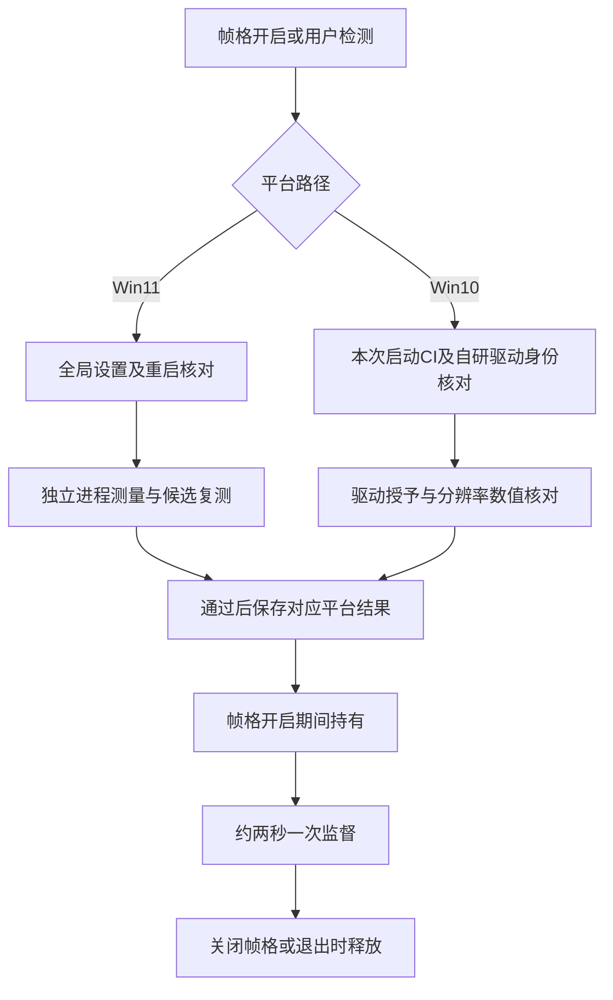

# 钟摆计划研究汇总

更新时间：2026-11-14，北京时间（UTC+8）。

本文汇总项目已有代码、静态逆向、历史实测、用户虚拟机日志及本地交付记录。它是研究归档，不是要求读者修改系统或安装驱动的操作脚本。初次整理只读取资料；后续本地接入及模拟验证另列，不等于新增真实计时器、CPU 压力、驱动加载或游戏验收。

**2026-11-14 后续更新：Win10 主程序已实现“玩家自备原版 DPC EXE”路径**，固定原版1.0000ms，核对自有进程/服务/系统读数，随帧格持有和正常释放，不再自动续办测试签名准备。主程序和研究插件均不分发 DPC 原件；尚未在真实 Win10 启动新路径。具体范围见 [Win10自备DPC主流程说明](Win10自备DPC的钟摆计划-20261114.md)。下文旧自研实验交付作为历史保留。

阅读顺序：先看第1节状态、第4节实际日志；原理和实现见第5～9节，验收范围与证据见第10～12节。

## 1. 当前结论与交付状态

1. **时钟分辨率回读、独立进程的实际等待、游戏收益是三个不同结论。** 查询显示 0.5ms，不能直接证明 `Sleep(1)` 约为 1ms，更不能证明帧率或输入延迟改善。
2. **Win10 用户态请求路径在已测 VMware 客体中没有通过跨进程效果准入。** 请求和系统查询可随 1→4→1ms 改变，无请求进程的实际等待仍约 15.6ms；底层唯一原因尚未确定。
3. **自研驱动的 Win10 数值路径已有用户客体日志中的正向结果。** 旧实验包的三轮临时请求均为请求/授予/当前值 0.5000ms，随后释放；这不是 Sleep、长期持有、游戏或最新 Alpha 包的完整验收。
4. **DPC 的关键机制已静态定位为内核精度请求的持有。** 并非必须依靠其图表或不断重复申请；本项目自研驱动没有复制其采样功能。
5. **任何方案都不能独占 Windows 的精度仲裁。** 实际参与仲裁的更细请求可能覆盖目标，持有者只能平衡自己的请求与释放责任。[微软接口说明](https://learn.microsoft.com/en-us/windows-hardware/drivers/ddi/wdm/nf-wdm-exsettimerresolution)
6. **Alpha0.935 的 Win10 主程序已新增玩家自备原版 DPC EXE 接入。** 只记录路径、核验原件，检测和保存后随帧格运行与正常关闭；安装包不含 DPC 原件或旧自研测试驱动，未验证实际 Win10 驱动加载。原研究插件与 r4 首次导入修复保持；Axia/PawnIO未接入。

| 对象 | 当前状态 | 已有证据能说明什么 | 尚不能说明什么 |
| --- | --- | --- | --- |
| Win11 用户态钟摆 | 已实现扫描、持有、监督、释放 | 历史原生短测、扫描结果和故障复现 | 全部机器长期有效、游戏必有收益 |
| Win10 早期用户态实验 | 客体跨进程效果未通过 | 读数变化与实际等待脱节 | 所有 Win10 都无解，或已唯一归因 VMware |
| Win10 自研驱动 | 保留历史源码/恢复说明；新版主路径改为自备DPC | 旧实验包临时请求 0.5ms、回读和释放跑通 | 最新DPC路径或反作弊兼容通过 |
| PawnIO 模块 | 已编译并完成解释器离线验证 | 固定协议和正常生命周期逻辑 | 官方已签名、能直接加载或异常清理完全可靠 |
| DPC 1.4.0 | 玩家自备EXE主流程和本地研究插件已实现；不分发原件 | 原件身份、固定1ms调用链、模拟生命周期、分离门禁 | 实际Win10运行、分发授权、反作弊兼容 |
| Axia 2.12.0.5 | 视频/厂商材料核对及独立实验器路径 | 原厂资料中存在相关计时器行为说明 | 本项目已证实其具体二进制调用或已获分发许可 |

## 2. 研究目标和术语

钟摆计划希望找到适合本机的计时器请求值，并在帧格开启期间保持请求、监督状态、关闭时释放。不同阶段有不同目标：Win11 研究实际等待；后续 Win10 驱动实验按用户要求先解决分辨率数值，不用虚拟机 Sleep 作为准入条件。

“降低分辨率数值”通常表示提高计时精细程度。例如 1ms→0.5ms；本文尽量直接写数值，避免“降低精度”一词歧义。

| 名称 | 含义 | 不能据此推出的结论 |
| --- | --- | --- |
| 请求值 Requested | 本工具提交的目标间隔 | 系统一定授予该值 |
| 授予值 Granted | 接口或驱动确认的实际值 | 此后永远不受其他请求影响 |
| 当前值 Current | 查询时观测到的系统读数 | 无请求进程或游戏一定获得同样等待粒度 |
| `Sleep(1)` 实测 | QPC 包围一次等待得到的实际耗时 | 固定上界、真实游戏帧时间或端到端输入延迟 |
| `KernelResolutionVerified` | 本项目驱动请求与数值回读核验通过 | 已验证跨进程 Sleep 或游戏效果 |
| `VerifiedGlobal` | 本项目相应用户态路径取得独立无请求测量证据 | 所有应用、所有负载永久有效 |
| 已保存 | 结果已耐久写入并回读，满足该平台身份 | 已经在帧格关闭时持续持有 |

本项目接口多以 **100ns** 为单位：`毫秒 = 原值 / 10000`。例如 5000=0.5000ms，5067=0.5067ms，10000=1.0000ms。DPC 原接口输入是微秒，其驱动再换算；不能混用。

系统时钟中断、QPC时间戳、等待完成和游戏帧呈现应分别记录；本研究没有证明修改请求间隔就能改善QPC计数精度或让GPU按同一间隔呈现。

微软公开文档说明 `timeBeginPeriod` 在 Win10 2004 前后存在作用范围变化，Win11 还有不可见窗口进程的默认处理。这是背景依据；本项目使用 `NtSetTimerResolution` 的现场行为仍需独立实验，不能把公开 API 的说明直接当作未公开接口的完整内部机制。[timeBeginPeriod](https://learn.microsoft.com/en-us/windows/win32/api/timeapi/nf-timeapi-timebeginperiod)

## 3. 视频和外部方案的来源

| 材料 | 已核对内容 | 证据限制 |
| --- | --- | --- |
| [原系列视频 BV1Ra4y1S7sF](https://www.bilibili.com/video/BV1Ra4y1S7sF/) | 调整 resolution 参数、负载观察；Win10 22H2 画面出现分辨率 0.5ms 而 Sleep 约15.6ms | 画面/字幕核对，没有完整音轨转写；作者机器结果不是通用常数 |
| [4.1：BV1Nc411971Q](https://www.bilibili.com/video/BV1Nc411971Q/) | 保持 DPC Latency Checker 1.4.0 运行，配合独立 MeasureSleep；隐藏和登录启动用于重新运行持有器 | 隐藏窗口不等于请求被永久写入系统 |
| [4.2：BV1M1421r7ew](https://www.bilibili.com/video/BV1M1421r7ew/) | 安装 Axia IP-Audio Driver 2.12.0.5；结尾画面为 Resolution 1ms、Sleep 约1.99～2.04ms | 不构成 Sleep 永远≤1.5ms、重启后永久有效的证据 |
| Axia 厂商历史说明 | 2.11.3.3 针对 Win10 2004/20H2 描述过全局 Sleep 行为调整 | 不能不经实测推广到 2.12.0.5、19045.6093 或其他系统 |

外部视频、附带 TXT/REG/快捷方式均作为研究输入，不是执行授权。具体视频核对与原始来源见[视频研究记录](../../../notes/Win10全局Sleep视频核对与Win11检测差异-20261104.md)。

## 4. 已有实测：分辨率数值与实际等待

### 4.1 Win10 用户态实验：查询变化，独立等待未响应

2026-11-13 用户 VMware 客体，系统 `10.0.19045.6093`，Exp1 路径。专用日志共55条，三轮 1→4→1ms，每点61个样本，共549样本：

| 检测开始（北京时间） | 1ms 请求下 Sleep 中位 | 4ms 请求下中位 | 再次1ms中位 |
| --- | ---: | ---: | ---: |
| 20:43:40 | 15.5012ms | 14.8418ms | 15.9917ms |
| 20:43:58 | 15.6221ms | 15.6604ms | 15.6668ms |
| 20:44:58 | 15.8080ms | 15.7992ms | 15.6398ms |

各点的请求、授予、当前及测量前后读数均匹配，18个持有/测量子进程都有退出记录。失败来自跨进程实际效果判据，不是没有请求成功、探针仍运行或没有进入检测。

当时准入要求：细档中位≤3ms，粗档3～10ms，粗细差≥0.75ms，两次细档差≤1ms。三轮均不满足前三项，所以不保存扫描结果是有依据的。2026-11-04 另一组同构建客体日志的15个测点、915样本，也出现约15.6ms的独立等待。

尚缺“同进程自请求自测”对照，不能唯一分辨 Windows 进程语义、虚拟化调度和其他因素。也不能推广为全部 Win10 不支持驱动路径。证据：[11月13日分析](../../../_buildcheck/win10-compatibility-diagnosis-20261113/conclusion-with-pendulum.md)、[11月4日分析](../../../notes/Win10虚拟机钟摆兼容检测日志分析-20261104.md)。

### 4.2 Win11 VMware：兼容通过，但候选扫描失败

重新核对用户提供的完整会话，系统 `10.0.26200.8037`，北京时间2026-11-13 23:48开始，共1947条记录：

- 五轮兼容性结果均为 `effective=true`；细档中位1.8347～2.0006ms，粗档4.3186～4.9174ms，已出现粗细响应。
- 两次正式扫描均 `Success=false`，消息为未找到满足0.5100ms下限及稳定性要求的复测，不保存锁定值；日志有366条 `scan-sample`。
- 因此“可以响应粗细变化”与“找到合格可保存候选”是两道不同门槛。不能把扫描失败解释为兼容探针没有执行。
- 用户另外提供的上一会话只有一条 `session-start`，它本身不能证明兼容性成功、失败或程序崩溃。

这些是虚拟机中对应旧实验包的测量，不能替代物理 Win11 或游戏验收。本次只重新解析原日志，没有重新运行测量。

### 4.3 Win10 自研驱动：三次0.5000ms临时请求已确认

用户最后提供的 Win10 内核路径日志，UTC 文件名日期为11月13日，对应**北京时间2026-11-14 03:49**；系统仍为 `10.0.19045.6093`。13条记录中包含：

| 项目 | 结果 |
| --- | --- |
| `scan-admission` | 3次，全部 `compatibilityOnly=true` |
| `kernel-resolution-confirmed` | 3次，请求/授予/当前均为5000，即0.5000ms |
| 数值状态 | `KernelResolutionVerified=true` |
| 跨进程效果状态 | `VerifiedGlobal=false`，等待统计为空 |
| 清理 | 3次 `release-confirmed` |
| 保存 | 没有 `kernel-precision-saved`，`ScanUtc=null` |

因此这份日志实际支持“**仅检测通过，临时请求已释放，尚未保存持有值**”。页面显示未保存，不能再简单解释为驱动无法工作；也不能反过来称为 Sleep 或游戏已通过。

它来自旧的 `win10-kernel-resolution-v2/` 实验包。最新 Alpha 增加的 v3 身份、CI 门槛和 r3 一键准备仍需在客体重新验收。原日志哈希和本次脱敏摘要见[附件复核摘要](../../../_buildcheck/pendulum-research-summary-20261114/attachments-summary.json)。

## 5. Win11 路径：扫描、持有与监督

### 5.1 工作流程

全局设置、重启确认、独立效果测量和长期持有是不同环节。单独写入 `GlobalTimerResolutionRequests` 或看见低查询值，均不足以代替实际效果检测。

Win11 的专用持有进程申请一次后保留会话；测量使用另一个不请求精度的进程。系统设置、操作系统身份、结果保存、进程生命周期和清理责任分别核对。检测或释放失败不应伪装成已有有效扫描。

### 5.2 两套扫描策略及历史修正

| 内部实现名称 | 当前界面别名 | 研究目的和方式 |
| --- | --- | --- |
| `LowestLatency` | 算法1（更稳定） | 典型低等待搜索，三级逼近及复测，再选安全侧锁定值 |
| `StableLatency` | 算法2（更激进） | 根据临界区抖动计算退让，核对空闲/标准负载/重载三个条件 |

内部枚举与界面别名有历史命名差异，不能仅凭名称判断当前算法行为。默认标准负载按逻辑核数约四分之一、限幅2～8线程；三条件验证每点至少三次重复、每次至少120样本。Win10 当前数值实验不运行这套压力搜索。

已复现并修复的算法问题包括：最粗端点失败就跳过整个区间、二分搜索假设候选合格性单调、下拉框改变却改写旧结果的模式标注。当前稳定策略从更细候选线性查找，再作半格细化；偏好模式与上次实际扫描模式分开保存。

稳定性判据后来改成相对候选自身间隔 `T` 的归一化形式。三个放宽档依次为：

| 判据 | 第1档 | 第2档 | 第3档 |
| --- | ---: | ---: | ---: |
| 每条件中位上限 / T | 2.20 | 2.35 | 2.50 |
| 在约2 tick档的重复比例参数 | 1.00 | 0.67 | 0.67 |
| 跨条件中位极差上限 / T | 0.35 | 0.50 | 0.60 |
| 慢样本比例上限 | 50% | 55% | 60% |

代码把比例参数换算为所需重复次数；这不是对任意未来样本的统计保证。目的是允许正常负载唤醒延迟上升，同时避免选中明显翻到约3 tick的候选。历史文档中的“绝对毫秒跨条件门限”和“二分选最小值”已被后续实现替代。[算法修复记录](../../../notes/钟摆计划双模式验收修复-20261103.md)、[当前扫描源码](../src/DeltaNFD.Execution/Execution/OptimalClock/OptimalClockScanner.cs)。

### 5.3 为什么不能把0.5ms写成所有机器的最佳值

历史32逻辑核机器的研究中，较小的请求值不总对应较低的实际等待：

| 请求 | 空闲 Sleep 中位 | 32线程负载下中位 |
| --- | ---: | ---: |
| 0.5000ms | 1.512ms | 1.507ms |
| 0.5180ms | 1.309ms | 1.042ms |
| 0.5300ms | 1.074ms | 1.072ms |
| 1.0000ms | 1.513ms | 2.001ms |

这是该次机器、请求环境和有限样本的结果；0.5300ms并不是项目承诺的通用推荐值。纯自旋负载也不能代表实际游戏。关于 C-state、相位或动态 tick 的解释仍属于假设，不应包装成已证实的唯一因果。[完整历史矩阵](../../../notes/不同精度高负载Sleep稳定性-20261103.md)

### 5.4 持有进程存活，不代表请求一直有效

历史现场曾观测到目标0.5170ms在进程仍存活时反复回落1ms。它表现为变粗，不能无证据地归因于另一个更细请求覆盖。

代码后来给持有子进程增加自身 `ProcessPowerThrottling` 策略设置及回读，在申请前明确保留精度请求；失败就停止申请。微软文档描述了该策略及 Win11 默认后台处理。[SetProcessInformation](https://learn.microsoft.com/en-us/windows/win32/api/processthreadsapi/nf-processthreadsapi-setprocessinformation)

短时回归支持这项修复，但早期 A/B/A 对照没有持续复现差异，所以仍不能宣称已唯一定位全部长期失效原因。两秒监督是检查与收尾节拍，不是精度绝不中断的保证。[故障现场](../../../notes/钟摆计划持续锁定失效排查-20261103.md)、[保留策略修复](../../../notes/钟摆计划持有进程精度保留修复-20261103.md)

## 6. Win10 自研驱动方案

### 6.1 机制与生命周期

自研 WDM 驱动通过 `ExSetTimerResolution` 持有请求。接口只接受版本化数值，固定24字节缓冲；设备限 SYSTEM/管理员、独占会话，没有任意地址/函数调用接口，也不复制 DPC 的延迟采样图表。

- 范围0.5000～1.0000ms，并核对系统支持范围；当前产品检测先试0.5ms，再试1ms。
- 加载驱动不等于已持有。请求由受控会话建立，同值重复不叠加引用。
- 主动释放、句柄 cleanup 和卸载处理本驱动的持有责任；异常或回读失败继续保留核对责任。
- 不在电源 IRP 中调用计时器申请，不用频繁重申请掩盖持有失效。
- 数值成功后，检测结束释放临时请求；只有显式保存通过并开启帧格时，才进入持有监督。

当前驱动源码见 [PendulumTimer.c](../native/PendulumTimer/PendulumTimer.c)，托管连接见 [PendulumKernelHolder.cs](../src/DeltaNFD.Execution/Execution/OptimalClock/PendulumKernelHolder.cs)，保存逻辑见 [ProcmanKernelPrecision.cs](../src/DeltaNFD.Execution/Execution/Procman/ProcmanKernelPrecision.cs)。

### 6.2 为何不以虚拟机 Sleep 准入

用户明确要求先把 Win10 分辨率拉下来，不再用客体 Sleep 阻止驱动数值实验。因此当前 Win10 路径只核对授予和系统数值，`KernelResolutionVerified=true` 与 `VerifiedGlobal=false` 可以同时成立。

这是一项明确的验收范围调整，不是把旧的15.6ms实测失败改写为成功。以后若要宣称游戏或跨进程等待改善，仍须另做相应实验。

### 6.3 签名与准备门槛

现有 SYS 有自研实验用测试签名，**不是微软生产签名**。此前对话中的“调试模式”，实际实现指 `TESTSIGNING` 测试签名模式，不是内核调试开关。启动配置的修改需要重启后才生效。[微软测试签名说明](https://learn.microsoft.com/en-us/windows-hardware/drivers/install/the-testsigning-boot-configuration-option)

Alpha0.935 对 Win10 要求本次启动 CI 状态、服务登记/运行、内核按需服务类型和规范路径、受保护记录及 SYS SHA 全部符合。缺失、未知或旧 IPC 证据均不开放持有；保存结果使用 `win10-kernel-resolution-v3/` 身份，绑定完整系统版本和驱动身份。

必须区分以下检查：Authenticode `Valid`、服务登记成功、内核加载成功、设备协议交换成功、精度回读成功、游戏兼容成功。它们不能互相替代。

因此当前不宜再笼统描述为“驱动完全没有签名”或“分辨率始终没有拉下来”。已有的是实验签名和旧客体数值成功；面向普通玩家的生产签名、安全及游戏环境验收仍是独立待办，未记录已取得微软生产签名。

### 6.4 安装与启动中已查明的问题

| 现象 | 已查明原因或边界 | 已完成处理 |
| --- | --- | --- |
| 1060：服务不存在 | 服务还未安装；Start不能替代首次Install | 增加状态说明，保持动作区分 |
| PowerShell中文乱码及17/24/25行解析错误 | 无BOM UTF-8被PS5.1按ACP936解码 | 加UTF-8 BOM，并用真实PS5.1解析/声明编译验证 |
| 123：文件名/目录名语法错误 | 旧脚本把驱动镜像路径当EXE命令行加引号 | 使用规范原生路径；已知旧路径可经受控RepairPath修正 |
| 577：Windows无法验证签名 | 用户当时开启TESTSIGNING后尚未重启；Valid不等于本次CI允许 | 完成重启后用户报告服务达到RUNNING，后续客体出现数值成功日志 |
| 仅检测成功仍显示未保存 | 检测模式不保存，本身是预期行为 | 页面/日志区分临时检测、保存和帧格持有 |

不应把全部577一律归因于没重启，其他系统策略仍可能拒绝。原路径错误的实际修复核对了既有归属和备份，不以删服务重装未知内容代替处理。[编码修复](Win10驱动准备脚本PowerShell51编码修复-20261114.md)、[路径修复](Win10驱动路径123与受控修复-20261114.md)

### 6.5 Alpha0.935 r3 一键准备的准确边界

主安装器只复制文件。玩家在钟摆页主动确认后，r3 才按固化文件身份记录原状态、备份 BCD、按需配置测试签名和精确公钥信任。需要时由玩家保存工作、手动重启、重新打开工具；随后续办驱动安装/启动和数值检测保存。

没有新增 RunOnce 或开机任务。授权与子进程阶段记录在受保护目录，未确认退出的写入进程不重复启动。续办不重新开启后来撤销的测试模式、补回撤销的信任，或自动重装准备完成后主动移除的驱动。它不关闭安全启动、内存完整性或磁盘保护，也不强制重启。

这一流程的编译、假环境及包核验已完成，最新 Alpha 在玩家 Win10/游戏环境的完整验收尚缺。[一键准备记录](Alpha0935一键准备Win10钟摆驱动-20261114.md)

## 7. DPC Latency Checker 的静态研究

### 7.1 分工与正常调用链

用户提供的“改精度”文件组合包含三个不同角色：

| 程序 | 静态定位的行为 |
| --- | --- |
| DPC Latency Checker 1.4.0 | GUI内嵌x86/x64驱动，按架构选择；驱动持有内核精度请求并进行延迟采样 |
| SetTimerResolution | 用户态读取resolution参数，申请后保持进程存在；附带参数5067代表0.5067ms |
| MeasureSleep | 查询分辨率，以QPC包围Sleep(1)；没有因此变成精度请求持有器 |

DPC GUI 正常开始操作提交默认1000微秒，驱动换算成10000个100ns单位，再通过 `ExSetTimerResolution` 持有。采样回调按间隔继续安排计时；停止和句柄 cleanup 路径释放请求。关键是尚未释放的内核请求，隐藏窗口本身不产生持久配置。

驱动有正常开始、停止和 cleanup 等不同释放路径，不能凭直觉额外叠加释放调用。静态代码能证明存在这些路径，不能直接证明所有异常、掉电或真实并发情况下的行为。

另两个工具的策略也不应混用：SetTimerResolution 的隐藏控制台仅改变界面；其尝试保留自身请求的调用没有检查返回值，不能据此断言任意 Win10 构建已经接受策略。

### 7.2 原件身份与结论边界

| 对象 | 字节数 | SHA256 |
| --- | ---: | --- |
| DPC 1.4.0原始EXE | 306928 | `00a7c7b88877bf59dbaa70de734fcd3f287f1eb92caff4571a4c8e67a5dc0aca` |
| 内嵌x64 SYS | 21232 | `636519d3293feb6779f089865c8c59a0763e720afefbad46fdb164fc06b9127e` |
| 内嵌x86 SYS | 18160 | `6871ebb5a285f7e9d34c89eae89414732dc29cd739622243a1770d09227b094c` |

已做资源完整性、导入、关键机器码及 cleanup 关联核对，37项静态证据检查通过；EXE和驱动的只读 Authenticode 为Valid。这不是动态执行、内核加载或反作弊验收。完整反汇编的线性扫描可能混有数据区，报告仅把另行定位复核的关键路径作为结论依据。

静态报告中“当时主程序只有用户态路径”属于较早阶段事实，已被后续自研驱动集成覆盖；它不意味着当前 Alpha 仍只有用户态。[完整静态研究](../../../_buildcheck/timer-static-reverse-20261114/逆向结论.md)

### 7.3 已知漏洞、授权及插件讨论

该版本有已公开的 [CVE-2025-51619](https://nvd.nist.gov/vuln/detail/CVE-2025-51619)，涉及本地低权限触发系统蓝屏的驱动缺陷。已存在的有效签名不会修复漏洞，也不构成反作弊允许加载的证明。厂商当前页面显示已不再提供该工具。[厂商页面](https://www.thesycon.de/deu/latency_check.shtml)

原程序内嵌条款要求再分发取得书面许可；当前没有该授权。先前讨论过安装包包含驱动、GitHub排除驱动，以及改成插件再分发；后两者不自动补足原厂权利。后续已实现用户自备原版EXE的本地研究插件及主程序接入，不包含原件、不提供下载或驱动提取。

当前只完成源码与私有载荷分离：公开目录保留原创代码和文件身份，检查Git索引、重命名原件及有限ZIP/gzip嵌套；成品构建在未授权/未通过安全审查时拒绝DPC载荷。没有把DPC装进插件或新安装包。[分离方案](../DRIVER_PAYLOADS.md)、[实施记录](DPC源码与私有载荷分离-20261114.md)

## 8. PawnIO、Axia 与 Windhawk 备选研究

### 8.1 PawnIO 受控模块

本地 PawnIO 原型提供请求、查询、释放三个固定接口，数值范围0.5000～1.0000ms并取硬件范围交集，可表达0.5067ms等具体值。不接受地址、任意函数名、PID或通用内核操作。加载不申请，每连接最多一份请求，同值幂等，正常关闭平衡本连接责任。

实际64位AMX由真实PawnPP解释器执行，原生计时函数替换为假实现，338项断言通过。它不是“只检查了一份伪代码”，也不是“真实内核已经运行”。

尚有三项关键限制：

1. 模块没有维护者签名，未被上游接受；官方受控加载链不能直接加载这份AMX。
2. 固定Modules头文件缺少驱动已有的 `data_v2p` 声明；原型本地声明，最低兼容版本仍待上游核定。
3. 原生变更异常可能发生在副作用之后；上游卸载回调的失败处理不足以保证所有异常下释放。原型遇未知结果冻结变更，不能声称异常清理已经完全解决。

它没有接入产品，也没有发送上游评审。固定版本、协议、正常与异常边界见[PawnIO研究记录](PawnIO受控计时器模块原型-20261114.md)及[模块README](../native/PawnIOTimer/README.md)。

### 8.2 Axia IP-Audio Driver

已有独立实验器保留原厂安装、许可、重启和卸载流程，第三方文件未嵌入交付ZIP。厂商2.11.3.3历史文档对Win10 2004/20H2有明确说明，视频使用2.12.0.5；当前资料不足以把前者效果等同于所有后者环境。

没有把其原厂签名、音频驱动用途或“视频中有效”当作计时器模块的任意再分发授权；也未将其作为主产品默认依赖。[独立实验器记录](../../../notes/Win10双方案独立实验器-20261104.md)

### 8.3 Windhawk Timer Resolution Control

另研究过用户态Hook方案。已核对的模组在被注入的进程内拦截 `NtSetTimerResolution`，按allow/block/limit规则限制过细请求；这与主动申请并保持较细精度不同。

若其block或较粗limit作用到钟摆持有器，可能抬粗本项目请求并触发核对失败。这是静态代码语义推论，未完成产品共存实测。本项目没有把该注入/Hook机制作为游戏侧实现，也没有把它当作安全取得第三方驱动能力的替代品。[Windhawk模组研究](../../../notes/Windhawk计时器分辨率控制模组解析-20261031.md)

## 9. 帧格“忽略三角洲精度请求”与钟摆的关系

忽略游戏自身请求与保留钟摆持有器自身请求，方向不同：前者允许系统不采纳目标进程的请求；后者要求持有器的请求被保留。两个地方都可能涉及 `PROCESS_POWER_THROTTLING_IGNORE_TIMER_RESOLUTION`，不能直接复制相同状态位。

历史自有子进程实验中，忽略自身请求可使实际等待回落约15.6ms，而外部持有1ms不一定救回。因此当前施加目标策略前仍要检查时钟可达性，不能只打开开关就认定游戏有高精度。

Alpha0.935 r2恢复了Win11和Win10实验入口，新配置默认关闭。Win10会先在独立短命进程上对自身试设/回读相关位，再检查目标身份与回读；失败、拒绝或静默无效不进入新的游戏写入，已有恢复记录仍处理。能力通过只证明该次策略交换，不能证明Sleep或帧率收益。

旧文档曾使用2.5ms可达阈值，当前源码为5.0ms；引用历史测试应保留当时阈值，不能当作最新代码参数。驱动分辨率成功也不代替该进程策略的能力检查。[最新恢复记录](Alpha0935恢复帧格精度忽略与Win10实验-20261114.md)、[当前可达性探针](../src/DeltaNFD.Execution/Execution/Procman/FrameTimerLegacyProbe.cs)。

## 10. 验证层级：哪些已经做，哪些还缺

| 层级 | 项目已有证据 | 仍需单独验证 |
| --- | --- | --- |
| 静态事实 | DPC正常路径/资源/单位；当前源码门槛 | 未覆盖函数和运行时差异 |
| 用户态模拟/解释器 | 自研驱动假内核、托管假设备、PawnIO真实AMX配假原生函数 | 真实内核ABI、异常与电源场景 |
| 构建/交付 | Alpha r3 21程序集、9自包含入口、30WinUI资源、1665文件解包SHA | 玩家机器安装、升级、GUI实际流程 |
| 用户客体日志 | Win10早期Sleep未响应；Win11兼容通过但候选失败；旧Win10驱动三次0.5ms及释放 | 物理机、最新Alpha准备和长期保持 |
| 历史本机原生短测 | 不同精度/负载矩阵、持有丢失与部分修复验证 | 长时间、不同硬件、睡眠唤醒等 |
| 真实游戏/反作弊 | 没有本研究足以作统一承诺的验收证据 | 准入、运行、退出恢复、帧时间与延迟对照 |

各阶段测试数字不能简单相加为一份“已全面验收”成绩。早期同源C假内核53/托管54，Alpha准备版本83/驱动后端77，PawnIO338，以及一键准备51/文件锁与ACL14，分别验证不同对象。其证据范围以相应 `final-result.json` 为准。

## 11. 后续实验应怎样设计

以下是研究待办，不是本次执行内容：

1. **分开验证请求、数值和效果。** 在同一系统比较基线、自请求自测、独立持有加无请求测量，再比较有无内核持有；记录请求/授予/当前和测量前后读数。
2. **区分虚拟机与物理机。** 同一输入在两类环境重复，不把客体调度等同物理游戏行为。
3. **验证生命周期。** 显式释放、正常退出、异常退出、反复开关、重启、睡眠唤醒和取消；保留未知结果，不以删除记录绕过。
4. **验证覆盖仲裁。** 更细、同值、更粗的外部请求分开测试；本工具释放后仍有其他请求时，不要求系统强行回到某个预设默认值。
5. **重新验证最新Alpha。** 旧自研v2客体成功不替代自备DPC路径验收；应核对原件选择、检测与保存、服务加载、帧格持有、正常关闭和中断重开。新版不再以TESTSIGNING/旧v3驱动身份作为主路径门槛。
6. **游戏效果另做对照。** 在目标环境允许的前提下记录实际帧时间/输入延迟，不能拿Sleep中位替代游戏收益，也不能拿“未被立即拦截”当作长期反作弊许可。
7. **生产分发另立条件。** 自研正式签名、第三方授权、上游模块接受与驱动安全审查均属于独立工作，不由插件形式或文件Hash核对自动完成。

## 12. 代码与证据索引

### 12.1 当前源码入口

| 路径 | 作用 |
| --- | --- |
| `src/DeltaNFD.Inspection/PendulumGlobalInspection.cs` | Win11准备及Win10平台分流 |
| `src/DeltaNFD.Inspection/PendulumWin10DriverInspection.cs` | 当前CI、服务和驱动身份核对 |
| `src/DeltaNFD.Execution/Execution/OptimalClock/` | 扫描、持有、策略、驱动客户端与监督 |
| `src/DeltaNFD.Execution/Execution/Procman/ProcmanKernelPrecision.cs` | Win10临时检测和结果保存 |
| `native/PendulumTimer/` | 自研C驱动、原始准备脚本和假内核测试 |
| `native/PawnIOTimer/` | 未签名AMX原型、固定依赖和离线解释器测试 |
| `native/DpcTimerLab/` | VMware限定的DPC实验接口草稿，非产品接入 |
| `tools/driver_payloads.py` | 源码与第三方载荷边界 |

本表路径相对 `_br222/s/`。主工作区根目录仍含历史源码，研究当前行为时优先读取此开发源，不把根目录旧文件当作最新产品。

### 12.2 核心证据目录

以下路径相对整个工作区，原始用户日志和第三方二进制不随本汇总复制：

| 路径 | 主要内容 |
| --- | --- |
| `_buildcheck/sleep-stability-20261103/` | 历史负载矩阵、原生测点和统计 |
| `_buildcheck/two-modes-20261103/` | 双模式与回退复现验证 |
| `_buildcheck/pendulum-lock-diagnosis-20261103/`、`pendulum-lock-fix-20261103/` | 持有丢失现场、正反对照及修复 |
| `_buildcheck/win10-timer-videos-20261104/` | 视频画面、字幕、厂商/接口参考 |
| `_buildcheck/win10-compatibility-diagnosis-20261113/` | 用户Win10早期Sleep准入分析 |
| `_buildcheck/timer-static-reverse-20261114/` | PE提取、关键反汇编和37项静态核对 |
| `_buildcheck/win10-kernel-hold-20261114/` | 自研驱动构建、签名与早期实验包 |
| `_buildcheck/win10-driver-ps51-encoding-20261114/`、`win10-driver-imagepath-20261114/` | 脚本编码、123路径及受控修复证据 |
| `_buildcheck/pawnio-timer-module-20261114/` | 未签名模块、真实AMX/假内核338项结果 |
| `_buildcheck/alpha0935-20261114/`、`alpha0935-timer-ignore-20261114/`、`alpha0935-driver-auto-20261114/` | Alpha初版、r2和r3本地包及解包验证 |
| `_buildcheck/dpc-payload-separation-20261114/` | 分离门禁、隔离Git/压缩容器/实际只读输入检查 |
| `_buildcheck/pendulum-research-summary-20261114/` | 本次汇总、三份附件脱敏复核及文档检查 |

### 12.3 本地版本边界

首次整理时显示版本Alpha0.935，内部0.9350，当时最新已交付本地包为（后续自备DPC主流程及诊断版见本文开头和第14节）：

`_buildcheck/alpha0935-driver-auto-20261114/package/DeltaNFD_Setup_0.9350_x64_r3.exe`

该包仍为自研测试签名驱动路径，未因后续DPC或插件讨论而自动改包；没有在本轮上传、发布、提交或推送。软件的计划方向、代码实现、已生成包、用户实际运行过的版本应始终分别记录。

## 13. 后续更新（2026-11-14 晚，非本次汇总范围）

在本文整理之后，另交付了一个**本地研究插件** `io.github.drxiaoxi.dpc-timer-hold` 1.0.0（`.dnfdplugin`）：它复现「保持原版 DPC 1.4.0 运行」的 4.1 方法，由玩家自备的原版 DPC 自行加载其签名驱动并持有 1.0000ms 请求，插件只负责启动、核验与释放。插件包不含任何 DPC 字节（190 项逐项 SHA256 与已知 DPC EXE/x86 SYS/x64 SYS 零命中），不直接驱动设备、不安装驱动；释放走宿主插件管理页的「恢复备份…」。静态依据是原版对话框过程 `0x40F810` 的 `WM_INITDIALOG` 分支调用 `0x40F930`，后者在 `0x40FC0B` 提交 1000 微秒开始请求。该插件**未在真实 Win10 启动 DPC/加载驱动**，不构成对本文第 1、4、10 节结论的改写，也不产生再分发授权或消除 CVE-2025-51619。详见 `notes/DPC计时器常驻Win10插件-20261114.md` 与 `_buildcheck/dpc-timer-plugin-20261114/final-result.json`。

## 14. 主程序自备DPC与VM超时反馈（2026-11-14 后续）

本地r5已把玩家自备原版EXE接入Win10主流程，不分发原件，不再续办旧测试签名准备；Win11保持原路径。用户随后提供Win10 19045.6093日志：原件核验通过，临时兼容性检测约15.38秒后失败，工具自己启动的DPC已正常关闭，未保存。用户确认原程序窗口正常、未报错。旧日志没有服务及数值现场，不能由此认定驱动加载失败或精度请求无效。

已复现并修复失败原因被正常清理清空的问题，本地r6保留原始异常，记录有界的服务状态/原始路径/长度与SHA/读取错误及当前分辨率；保持原准入标准。102项新路径检查通过，但用户VM究竟哪项未通过仍待r6日志确认。详情见 [DPC核验超时原因丢失与诊断修复](DPC核验超时原因丢失与诊断修复-20261114.md)。

## 15. r6现场已定位文件名误判（2026-11-14 后续）

r6新日志显示服务RUNNING、当前1ms；实际路径是`\??\C:\Windows\system32\drivers\dpclat_driver.sys`，工具却只认`dpclat.sys`，因此尚未进入驱动长度/SHA核验就被拒绝。r7修复这个明确的本工具误判，保留内容身份和其他准入条件，120项检查通过；提供完整包与适用r6的单DLL小补丁。用户客体实际应用与文件内容核验仍待验收，不把当前读数等同Sleep/游戏收益。详见 [DPC实际驱动文件名误判与r7修复](DPC实际驱动文件名误判与r7修复-20261114.md)。

## 16. 用户Win10客体临时检测通过（2026-11-14 22:41）

后续用户日志`pendulum_20261114T144132395_7816_12d062d4af564f19ad5657962a757239_0000.jsonl`含三次临时兼容性检测：全部`compatibilityOnly=true`、`accepted=true`、`DpcProcessVerified=true`、`Current100ns=10000`、无错误，随后均有`release-confirmed`。这补充了修复后用户Win10 19045.6093客体的真实短时数值检测与释放正向证据；仍未保存或长期持有，也没有Sleep/游戏或反作弊实效证据。

截图“尚未检测保存”是因为玩家三次都点了“仅检测DPC（不保存）”。应点“检测并保存持有值”，成功后开启帧格；本轮没有新的产品修改或打包。

## 17. Win10 复用算法1/2与联合持有（2026-11-14 后续）

用户随后明确要求扫描最优值并持有。r8在DPC固定1ms基底上，由工具自己的额外进程请求候选，复用未改动的Win11扫描器，严格核对候选数字与独立等待并复验实际联合持有；基础1ms方式保留。保存来源另加`/algorithms-v1`，帧格按已保存方式持有和释放。新60项模拟及原回归通过，完整包/独立解包已核验；尚未在Win10运行新扫描或证明游戏效果。详见 [Win10引入算法1与2联合持有](Win10引入算法1与2联合持有-20261114.md)。

## 18. DPC持续隐藏主窗口（2026-11-15 后续）

用户要求持续隐藏运行。r9新增默认开启的“隐藏 DPC 主窗口”：既有核验成功后每秒维护工具拥有的原版主窗口，取消勾选可恢复显示，启动时可能短暂显示，错误弹窗保留。释放改为包括隐藏窗口的精确识别和正常关闭，异常退出后的显式核对也能定位隐藏窗口；不强杀、不隐藏进程、不改变扫描或持有数值。21项窗口检查（含本测试进程初始隐藏窗口的原生关闭）和既有回归通过，完整包及独立解包已核验。尚未实际运行DPC或在Win10验证隐藏效果，详见 [DPC持续隐藏窗口与正常释放](DPC持续隐藏窗口与正常释放-20261115.md)。

## 19. 准备完成后显示帧格钟摆与双平台联动（2026-11-15 后续）

r10按当前准备和检测保存来源决定帧格钟摆项可见性。Win11先持有对应精度再自动核验忽略三角洲请求；Win10同时保持DPC后台运行，算法方式继续联合持有。旧独立忽略开关收进联动，旧偏好不能绕过门槛。后台循环及首次同步统一顺序，停止时先恢复策略再释放请求，恢复失败保留记录和错误。新102项、真实循环替身656项及原回归通过，真实系统/游戏效果仍待验收。详见 [帧格钟摆准备门槛与双平台联动](帧格钟摆准备门槛与双平台联动-20261115.md)。

## 20. 自定义游戏的帧格优先级与精度忽略（2026-11-15 后续）

完整性检查发现r10两条帧格分支仍固定三角洲，用户随后要求适配。r11通过统一目标服务按完整路径/身份/代次筛选当前游戏，并在写入前复核；自定义恢复记录绑定原映像，旧三角洲记录保持兼容。新32项及自建惰性进程实际路径5项通过，属性与时钟仍为模拟接口；没有真实游戏或DPC验收。详见 [不玩三角洲辣模式帧格目标适配](不玩三角洲辣模式帧格目标适配-20261115.md)。

